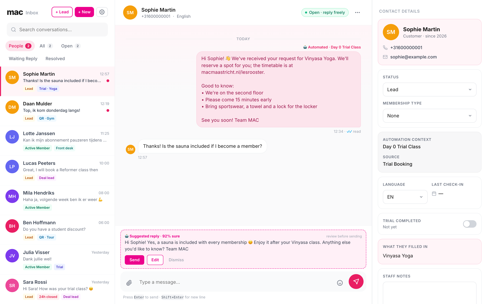
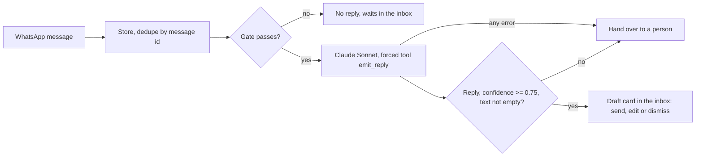

# MAC SportsClub WhatsApp agents

The WhatsApp automation I built and run for [MAC SportsClub](https://macmaastricht.nl) in Maastricht, a gym with two buildings and about 1,300 active members. It has been live since April 2026: 20 n8n workflows that reply to new leads within minutes, follow up trial classes, nudge members who stop coming, offer upgrades, and hand anything uncertain to the front desk.

Two parts use Claude:

- **A trial classifier** (Claude Haiku 4.5) reads every website trial request and picks the first WhatsApp message the person gets, or hands it to a person. It runs on every real request.
- **A WhatsApp assistant** (Claude Sonnet 4.6) answers FAQ questions and drafts replies for staff to approve. It is built and tested, and runs only for my own test number until the club's data processing agreement covers the model provider.



*The real inbox code, running against a mock API with made-up people.*

## What's here

| Folder | What it holds |
| --- | --- |
| [`assistant-harness/`](assistant-harness/) | The assistant's prompt, gate, Claude call and a 33-case eval, runnable locally. It mirrors the production nodes. |
| [`n8n/`](n8n/) | Ten Code nodes and one request body exported from the live workflows: the assistant, the classifier, phone validation, the live member check, the inactivity re-check, delivery receipts and the health check. |
| [`docs/architecture.md`](docs/architecture.md) | How data flows, how both agents decide, the member lifecycle and the daily schedule. |
| [`docs/lessons.md`](docs/lessons.md) | The rules production taught me, each traced to the incident behind it. |

## Run the eval

Node 18 or newer, no dependencies.

```bash
cd assistant-harness
node run.js --gate-only                       # the gate logic, no API calls
ANTHROPIC_API_KEY=sk-ant-... node run.js      # all 33 cases against the real model
ANTHROPIC_API_KEY=sk-ant-... node chat.js     # talk to it in the terminal
```

Decisions (reply, escalate, or stopped by the gate) are scored automatically. Reply wording is read by a person.

## How the assistant decides



The model has one tool, and it can only produce a reply. Every outcome that isn't a clean, confident reply ends with a person. More in [`docs/architecture.md`](docs/architecture.md).

## Data protection

This repository holds no member data. In particular:

- No names, phone numbers, e-mail addresses or messages of members or leads. Names that appeared in code comments were replaced by a role ("a member").
- No secrets. Tokens in the exported n8n code appear as `${NAME}` placeholders; the live system holds the real values.
- No account identifiers. Airtable base, table and record ids, WhatsApp account ids, the Virtuagym club id, n8n workflow ids and server addresses are replaced with placeholders.
- The screenshot uses made-up people, and the eval cases use invented first names.
- `faq.md` holds only what the front desk tells any customer: opening hours, prices and offers as of October 2026.

## Not included

The inbox UI and the other workflows (intake routing, the data syncs, upsell and plan upgrade, payment reminders, reports). I'm happy to walk through any of them.
