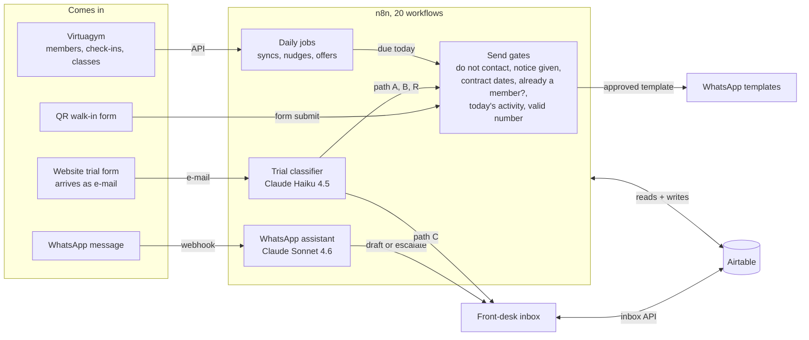
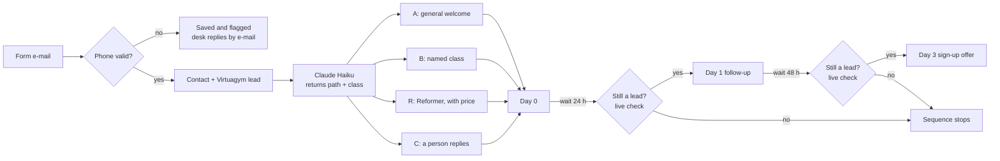
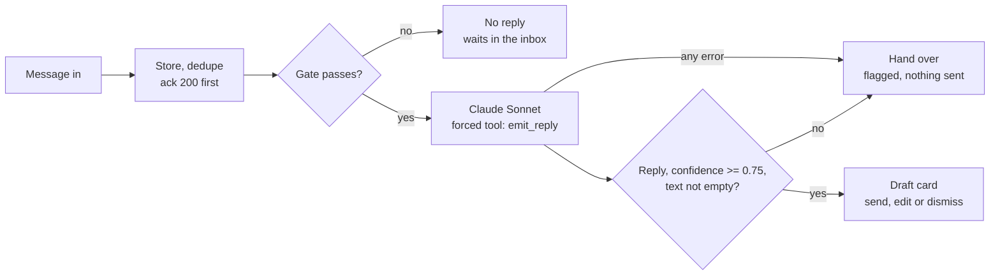

# Architecture

Everything runs on a self-hosted n8n server. Most of the logic is JavaScript inside n8n Code nodes: a heavy job is one node that fetches, joins, plans and batch-writes, instead of a dozen chained low-code nodes. Virtuagym (the club's member system) is the source of truth for members, check-ins, classes and invoices. Airtable is the working store that the automations and the inbox share.

## How data flows

Every template send passes the same gates, whichever agent or job started it.

## Agent 1: the trial classifier

The request body is in [`n8n/trial-classifier/1-classifier-request.n8n-expression.js`](../n8n/trial-classifier/1-classifier-request.n8n-expression.js) and the parser in [`2-parse-classification.js`](../n8n/trial-classifier/2-parse-classification.js). Anything the parser can't read becomes path C, so a person replies.

The live check ([`n8n/lead-intake/live-member-check.js`](../n8n/lead-intake/live-member-check.js)) asks Virtuagym whether the person has already joined, because the CRM status only updates once a day. If Virtuagym can't be reached, nothing is sent.

## Agent 2: the WhatsApp assistant

Three Code nodes inside the inbound webhook workflow:

1. [`1-bot-gate-prep.js`](../n8n/whatsapp-assistant/1-bot-gate-prep.js): on/off switch, test allowlist, repeat delivery, non-text, opt-out keyword, empty, do-not-contact, a staff member has claimed the thread, own number, a 20-second rate cap. Then it reads the staff-editable settings and the class timetable and builds the request.
2. An HTTP Request node posts that body to the Messages API with n8n's stored Anthropic credential.
3. [`3-bot-decide-act.js`](../n8n/whatsapp-assistant/3-bot-decide-act.js): reads the tool call, applies the threshold, converts Markdown to WhatsApp formatting, and writes a draft, sends (auto mode, test number only), or flags the thread for a person.

## The member lifecycle

| Stage | What runs |
| --- | --- |
| Lead | First WhatsApp within about two minutes of a form or QR scan; the classifier picks it; the lead is created in Virtuagym |
| Trial | Day 1 and Day 3 follow-ups after a live check; an attendance follow-up at 11:30; a nightly booking check so nobody who booked is asked again |
| Member | Nudge after 14 to 60 days without a visit or class; upsell for members who train often; plan upgrade from 8 to 52 weeks; payment reminders (dry run) |
| Notice given | Every offer and nudge stops; they stay a member until the contract ends |
| Left | Win-back sequence, built and tested, switched off by the club |

## The daily schedule

| Time | Reads data | Sends | Watches |
| --- | --- | --- | --- |
| 06:00 | Class timetable for the assistant | | |
| 08:00 | Invoices (read only) | | |
| 10:00 | Check-ins and contracts | Payment reminders (dry run) | |
| 10:15 | Class attendance | | |
| 10:30 | | | Health check, e-mail alerts |
| 11:00 | | Inactivity nudge, upsell, plan upgrade | |
| 11:30 | | Trial attendance follow-up | |
| 22:00 | Bookings and tours | | |

The 10:00 and 10:15 syncs write what the 11:00 senders read, but they can't see today's visits, so each inactivity nudge re-checks today's activity live just before it goes out ([`n8n/inactivity-nudge/live-activity-recheck.js`](../n8n/inactivity-nudge/live-activity-recheck.js)). On Mondays at 09:00 a weekly report goes to the club. Form e-mails, walk-ins, WhatsApp and the inbox run on events, all day.
